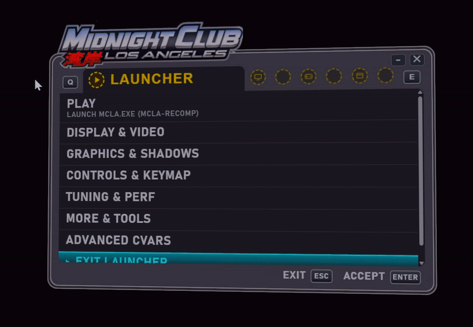

# MCLA PC Launcher (standalone)

A transparent WebView2 launcher UI for **Midnight Club: Los Angeles (PC recomp)**.



The visual target is the game's own menus: the same typography, spacing, motion and HUD language, so the launcher feels like part of Midnight Club rather than a generic AI-looking settings wrapper.

This is a **separate project** from the game (`mcla pc`). It produces `mcla_launcher.exe`,
which you copy next to `mcla.exe` in the game's `build/` directory. It never modifies
`mcla.exe`.

## Why it exists

The old in-tree launcher was a GDI+ dialog. This one is a 650×446 borderless, **transparent**
WebView2 window hosting the launcher UI from `ui/index.html`. True per-pixel alpha is achieved
with Win32 `WS_EX_NOREDIRECTIONBITMAP` + DirectComposition and
`ICoreWebView2Controller3::put_DefaultBackgroundColor({0,0,0,0})`.

Measured dead ends (do not re-try):

| approach | result |
|---|---|
| WinForms `TransparencyKey = magenta` | magenta renders **visible** (WebView2 child HWND ignores parent color key) |
| WPF `AllowsTransparency=True` | transparent, but WebView2 **input is dead** |
| C++ Win32 + DirectComposition (here) | **transparent + input works** — verified |

## Layout

```
mcla-launcher/
  src/mcla_launcher.cpp     the whole host (Win32 + WebView2 COM + DirectComposition)
  ui/                       the launcher UI (index.html, schema, bridge, logo, examples)
  deps/                     WebView2Loader.dll + .lib (pinned, x64)
  sdk/                      WebView2.h + WIL headers (build-time only)
  launcher.ico              window/taskbar icon (the 湾岸 badge)
  build.bat                 build script -> out/mcla_launcher.exe
  VERIFY_*.png              proof screenshots (UI + transparency)
```

## Build

Requirements: VS BuildTools (vcvars64), LLVM `clang-cl`, WebView2 Runtime installed.

```bat
build.bat
```

Output: `out\mcla_launcher.exe`. Then copy `out\mcla_launcher.exe`, `out\WebView2Loader.dll`,
`out\launcher.ico` and the `out\launcher\ui\` folder into the game's `build\` directory.

The host auto-detects paths:
- `mcla.exe` — next to the exe, or `..\build\mcla.exe`
- UI — `<exe dir>\launcher\ui`, or `<repo>\tools\launcher\ui`
- `cache/mcla.toml` — `<exe dir>\cache`, or `<repo>\build\cache`

## Host commands (AGENT_HANDOFF.md §4)

| action | handler |
|---|---|
| `ready` | reads `cache/mcla.toml` and calls `MCLALauncherAPI.loadConfig(json)` |
| `dragWindow` | `WM_NCLBUTTONDOWN/HTCAPTION` (also top 24px strip via `WM_NCHITTEST`) |
| `launchGame` | writes `payload.extra.toml` to `cache/mcla.toml`, spawns `mcla.exe` |
| `saveConfig` | writes `payload.extra.toml` |
| `browseFiles` / `openLogs` | opens game dir / cache dir |
| `minimizeWindow` / `exitLauncher` | window control |

## Verify

1. `Start-Process build\mcla_launcher.exe`
2. `PrintWindow` capture → UI renders; desktop `ImageGrab` crop → desktop shows through.
3. Click a nav row → UI navigates (input works).
4. `build/mcla.exe` mtime unchanged.

Both proof images are in `VERIFY_UI.png` and `VERIFY_TRANSPARENCY.png`.
